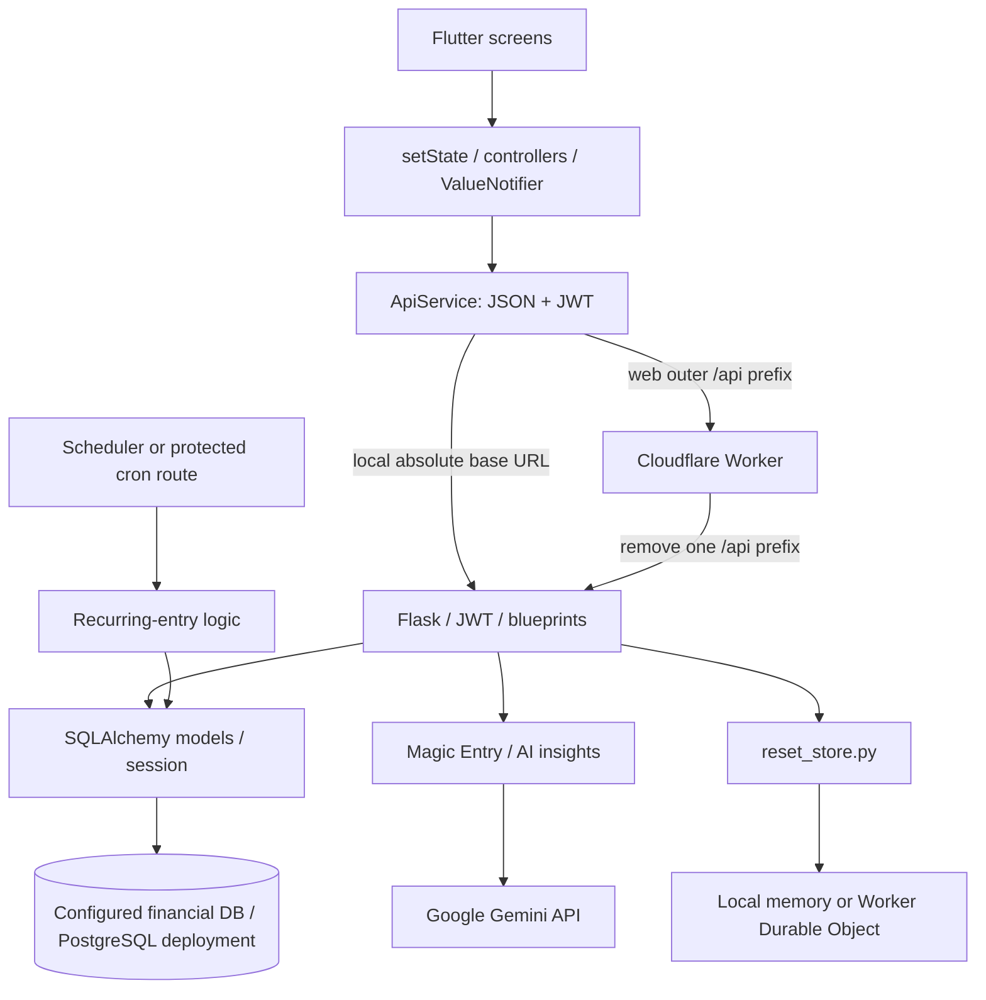

# SpendWise — Complete Technical Documentation

Inspected: 31 October 2026. Root: `C:\Flutter practice\SPENDWISE`. Paths below are repository-relative; function names refer to their source files (Dart widget methods usually belong to State classes).

## Evidence and overview

This document describes source-verified behavior. Execution evidence and unverified areas appear in section 12. Design rationale is an interpretation of the implementation, not a claim about the author's original intent. Generated files, caches, node_modules and virtual environments were excluded from source analysis. No application source was modified, secrets disclosed, production financial operations invoked or live AI calls made.

SpendWise implements personal income/expense tracking, category budgets called goals, recurring entries, analytical charts, natural-language transaction entry, personal outing-debt tracking, accounts, profile/avatar/currency preferences, notifications and CSV/PDF exports. Auto-billing, payment methods and debt settlement record information; no bank or money-transfer integration was found.

## 1. Repository and architecture

```text
SPENDWISE/
├── SpendWise/
│   ├── lib/
│   │   ├── main.dart
│   │   ├── controllers/ transaction_controller.dart, notification_controller.dart
│   │   ├── models/ transaction.dart, goals.dart, subscription.dart, app_notifications.dart
│   │   ├── services/ api_service.dart, notification_service.dart, export_service.dart
│   │   ├── themes/ app_theme.dart, spendwise_doodle.dart
│   │   └── views/
│   │       ├── splashscreen.dart, welcome_screen.dart, login_screen.dart
│   │       ├── register_screen.dart, forgot_password_flow.dart, onboarding_screen.dart
│   │       ├── avatar_selection_page.dart, profile_page.dart, settings.dart
│   │       ├── homepage.dart, floatingactionbutton.dart, magic_entry_button.dart
│   │       ├── goals.dart, analysis.dart, notification_page.dart
│   │       └── outings_page.dart, new_outings_page.dart, subscription_manager.dart
│   ├── assets/ (avatars, illustrations, logos)
│   ├── android/, ios/, web/, windows/, linux/, macos/ (Flutter platform hosts)
│   ├── test/widget_test.dart
│   └── pubspec.yaml, pubspec.lock, analysis_options.yaml
├── expense_tracker_backend/
│   ├── app.py, config.py, cron.py, reset_store.py
│   ├── models/ database.py, user.py, transaction.py, goal.py, outing.py,
│   │           subscriptions.py, notification.py, category.py, __init__.py
│   ├── routes/ auth.py, transactions.py, goals.py, outings.py, subscriptions.py,
│   │           notifications.py, categories.py, magic.py, analysis.py, __init__.py
│   ├── tests/test_deployment.py
│   ├── requirements.txt, .env.example, .python-version
│   └── Dockerfile, gunicorn.conf.py, vercel.json, .dockerignore, .vercelignore
├── deployment/ worker.js, worker.test.js, build-web.ps1, _headers, README.md
├── package.json, package-lock.json, wrangler.jsonc, README.md
└── docs/ (this document and interview reference)
```

This source-oriented tree omits secret files, build output, Git and local deployment metadata. A backend `instance/` directory also exists; its presence alone does not identify the configured database. No migration package or independent domain-service layer was found.

Flutter screens use local state and ordinary controller objects; `ApiService` sends JSON with JWTs. Flask blueprints implement API operations and SQLAlchemy persists relational models. Most backend logic lives in routes and `cron.py`. Outing splits, budget totals and charts are computed in Dart.

Financial database selection comes from private `DATABASE_URL`. PostgreSQL is the deployment target supported by psycopg2, TLS/pooling configuration and advisory-lock code. Historical `deployment/README.md` identifies Supabase PostgreSQL; a live DB connection was not made for this analysis. Tests use in-memory SQLite. A separate SQLite-backed Cloudflare Durable Object stores temporary password-reset state, not financial records.



Responses become Dart models or maps. After mutations, screens refresh or update local state. There is no websocket synchronization or universal reactive financial store.

## 2. Flutter frontend

### Initialization, state and JSON

`SpendWise/lib/main.dart::main` initializes bindings, notification service/permission and SharedPreferences, restores preferences and runs `MyApp`. Global `themeNotifier`, `currencyNotifier`, `avatarNotifier` are ValueNotifiers. `MyApp.build` listens for theme changes but forces dark themes and `ThemeMode.dark`; the stored theme preference does not switch to light mode. A wide-screen wrapper presents a phone frame and fixes text scale.

`SpendWise/lib/services/api_service.dart::ApiService.baseUrl` reads compile-time `API_BASE_URL`, default `/api`. `_headers` adds JSON content type and stored JWT. `saveToken/getToken/clearToken` use SharedPreferences key `jwt_token`. `isLoggedIn` tests token presence, not expiry. `logout` only removes the token. There is no refresh/revocation flow.

Most API reads return empty lists/null on HTTP/network failure; writes return booleans. Failed reads can resemble empty data. There is no explicit frontend timeout/retry policy. `jsonEncode/jsonDecode` bridge requests/responses; `Transaction`, `Goal`, `Subscription`, `AppNotification` in `SpendWise/lib/models/` implement `toMap/fromMap`, mapping snake_case fields and parsing dates/numbers. Malformed successful data can still fail during model conversion.

`controllers/transaction_controller.dart::TransactionController` stores `allTransactions` and `isLoading`. `loadTransactions` converts API maps. `addTransaction` appends the original local object on success; the generated server ID arrives after reload. It does not extend ChangeNotifier: parents rebuild with `setState` and callbacks. No Provider/Riverpod/Bloc dependency is declared.

### Screen and functional-method inventory

All paths in this list start with `SpendWise/lib/`.

- `views/splashscreen.dart::SplashScreen.initState`: delayed token check and replacement navigation to home/welcome.
- `views/welcome_screen.dart::WelcomeScreen`: timed introduction carousel and login/register navigation; no financial fetch.
- `views/login_screen.dart::_login`: form validation, `ApiService.login`, then home navigation; service stores JWT.
- `views/register_screen.dart::_register`: registration, automatic login, then onboarding; falls back to login if needed.
- `views/forgot_password_flow.dart::_sendOtp`, `_resendOtp`, `_verifyOtpAndNext`, `_saveNewPassword`: email/code/password flow. Code-screen verification is local format validation; backend verifies and consumes the code on final reset.
- `views/onboarding_screen.dart::_finishSetup`: profile update, local preference/notifier update, navigation to home. `views/avatar_selection_page.dart::AvatarSelectionPage` returns a bundled asset choice.
- `views/homepage.dart::MyHomePage`: owns transaction/notification controllers and `_goals`. `_loadData` sequentially loads transactions, goals, notifications and profile, updates currency/name and checks goals. Runs on initialization, app resume, home-tab selection and mutations. `build` switches Home/Goals/Analysis/Settings; Navigator/MaterialPageRoute opens other screens. PopScope returns non-home tabs to home.
- `views/floatingactionbutton.dart::FloatingAction`: manual form. `_onSave` validates and posts a Transaction; optional recurrence posts a Subscription separately. `_fetchGoalsAsCategories` adds goal names. Category dialogs create, rename and delete through API calls.
- `views/magic_entry_button.dart::MagicEntryButton`: animated launch button; home `_showMagicEntrySheet` implements input/submission.
- `views/goals.dart::GoalsPage`: `_spentForGoal` derives spending, remaining and progress. `_showCreateGoalSheet`/`_showEditGoalSheet` open `_GoalForm`; its state's `_submit` calls add/update and refresh callback. `_confirmDeleteGoal` deletes and refreshes.
- `views/analysis.dart::AnalysisPage`: `_filteredTransactions`, `_categorySpends`, `_buildTrendChart`, `_showingSections` calculate chart data; `_showLineFilterDialog` changes series; `_generateInsights` requests AI advice.
- `views/outings_page.dart::OutingsPage`: `_loadOutings` reads nested maps; `_openOutingForm` creates/updates; `_showSettleDialog`/`_applyPayment` settle debts. `OutingCard` owns expanded state.
- `views/new_outings_page.dart::NewOutingPage`: member/event editor, historical JSON restoration, `_calculateAndSave`. Returns a result through Navigator; makes no HTTP call itself.
- `views/subscription_manager.dart::SubscriptionManager`: `_loadSubscriptions`, `_showEditSheet`, `_deleteSubscription`; reloads after writes.
- `views/notification_page.dart::NotificationPage`: supplied-controller notification display and mark-all-read on entry; `_timeAgo` formats timestamps.
- `views/profile_page.dart::ProfilePage`: `_loadUserData`, `_saveProfile`; backend persists name/currency/avatar. Phone/language fields in model responses do not imply backend editing support.
- `views/settings.dart::SettingsPage`: `_loadLocalSettings`, `_loadUserProfile`, currency, goal-alert preference, profile/subscriptions, clear confirmations and `_confirmLogout`. Language support, permissions settings and privacy policy call `_showComingSoon`.

`themes/app_theme.dart` centralizes themes and `themes/spendwise_doodle.dart` is decorative. Ordinary layout widgets have no separate business role.

### Dashboard, filters and forms

Home getters `filtered`, `totalIncome`, `totalExpense`, `balance` delegate to `TransactionController.getFiltered/getTotalIncome/getTotalExpense/getBalance`. Income sums non-expenses, expense sums expenses, balance = income − expense. This is selected-period net flow, not a bank balance. No `/dashboard` endpoint exists.

Filters are Today, Yesterday, This week (Sunday start), This month and Custom (single calendar day). The week filter has only a lower bound and can include future records. `_showTransactionOptions`, `_showEditSheet`, `_confirmDelete` implement editing/deletion and refresh. The actual edit UI sends title/amount/date; the backend supports more fields.

Manual categories begin with Food/Hobbies/Study/Travel/Extra and Salary/Bank Interest/Selling/Business/Allowance, merged with past transaction categories and goal names. Creating a custom category posts it and updates the current chooser. No `ApiService.getCategories` exists despite a backend GET route; an unused custom category can disappear when reopening the chooser.

The manual transaction form requires a nonempty trimmed purpose and a parseable amount greater than zero; its amount formatter permits up to two decimal places. `_isSaving` controls submission feedback. Date pickers and payment/category controls update local state; changing income/expense changes the available choices. These UI checks do not replace server validation for direct API callers.

Recurring creation first commits an ordinary transaction, then posts Subscription independently. The subscription result is ignored by `_onSave`, so its failure does not undo the transaction. Initial Dart monthly/yearly date construction can overflow month-end dates; backend recurrence later clamps dates instead.

## 3. Database and persistence

`expense_tracker_backend/models/database.py` defines shared `db = SQLAlchemy()`. Each model below has integer PK `id` and a `to_dict` serializer. Tables are defined in models, not a separate SQL schema. No migration history was found. `app.py` calls `db.create_all()` only when executed directly; production import of `app:app` neither creates tables nor migrates columns.

| Table / source under `expense_tracker_backend/models/` | Fields and relationships |
| --- | --- |
| users — `user.py::User` | unique non-null email, non-null password hash, name, currency, language, profile_pic, phone, created_at. Serializer exposes profile_pic as avatar and omits password. |
| transactions — `transaction.py::Transaction` | non-null title/Float amount/date/category/user_id; is_expense, payment_method, created_at. user_id FK to users.id; category is a string, not FK. |
| goals — `goal.py::Goal` | name, legacy category, Float budget_amount, start_date/end_date, nullable alert_threshold, user_id FK. Routes mirror category=name. No contribution/balance column. |
| subscriptions — `subscriptions.py::Subscription` | title, Float amount, is_expense, category, payment_method, frequency, next_billing_date, created_at, user_id FK. No billing-history/transaction link. |
| outings — `outing.py::Outing` | title, location, string date, raw_events Text, created_at, user_id FK; debts relationship uses all/delete-orphan cascade. |
| outing_debts — `outing.py::OutingDebt` | outing_id FK, friend_name, Float amount, is_owed_to_me, is_settled. Friends are labels, not registered-user links. |
| notifications — `notification.py::Notification` | title, message, type, is_read, created_at, user_id FK. |
| categories — `category.py::Category` | name, icon, color, user_id integer without FK, is_default, created_at. No database uniqueness constraint on owner/name. |

Financial amounts use Float rather than Decimal or integer smallest units. There is no per-transaction currency or exchange conversion. Changing profile currency relabels existing amounts.

Creates use session.add/commit; edits modify ORM fields and commit; deletes use session.delete or bulk deletion. Outing creation flushes to obtain its ID before inserting debts, then commits together. Editing deletes old debts and inserts replacements. No separate event/participant tables exist: raw_events is JSON encoded as Text; personal net debts are materialized rows. Dashboard, chart and goal totals are recomputed, not stored. Outing payments do not create Transaction rows and therefore do not automatically affect dashboard totals.

## 4. Backend initialization and complete route reference

`expense_tracker_backend/app.py` creates Flask, loads `config.py::Config`, initializes CORS/JWTManager/db, registers blueprints, and configures the subscription scheduler. Config loads backend `.env`; DATABASE_URL/JWT_SECRET_KEY are required at import. The JWT secret must be at least 32 characters and not the placeholder. Access tokens expire after 30 days. CORS uses comma-separated exact origins. PostgreSQL pooling has pre-ping, recycling, bounded pool/overflow, TLS and connection timeout. `private_responses` adds private/no-store and nosniff headers.

All business routes require Bearer JWT except explicitly public auth routes. Caller names below are methods of `SpendWise/lib/services/api_service.dart::ApiService`. These are **Flask paths**: web proxy adds one outer `/api`. Thus `/transactions` is publicly `/api/transactions`, and `/api/magic/entry` is publicly `/api/api/magic/entry`. Local direct Flask baseUrl must be an absolute origin without `/api`. Worker removes exactly one outer prefix. No PATCH handler is implemented; framework HEAD/OPTIONS are implicit.

### Accounts — `expense_tracker_backend/routes/auth.py`

| Method/path → function | Request, database/business behavior, response, Flutter caller |
| --- | --- |
| POST /auth/register → register (public) | `{email,password,name?}`; duplicate lookup gives 400 success:false/message. Werkzeug hashes password, inserts User/commits; 201 success:true/message. Caller register. No comprehensive required-field/email/password-strength validation. |
| POST /auth/login → login (public) | `{email,password}`; lookup/check_password_hash; JWT identity=str(user.id). 200 `{success,token,user}`, otherwise 401 success:false/message. Caller login. |
| GET /auth/profile → get_profile | User by JWT identity; 200 User dictionary. Caller getProfile. Missing-user handling is not explicit. |
| PUT /auth/profile → update_profile | Optional name/currency/avatar; avatar maps to profile_pic; commit and return user 200. Caller updateProfile. Does not update phone/language/email/password. |
| POST /auth/forgot-password → forgot_password (public) | `{email}`; unknown user gives generic success 200; known user issues OTP and logs it to console. Store failure 503, success 200. Caller forgotPassword. No email sender integration. |
| POST /auth/reset-password → reset_password (public) | `{email,otp,new_password}`; checks email/password types/nonempty password, consumes code, hashes/commits password. 400 invalid request/code, 503 store unavailable, 404 user absent, 200 success. Caller resetPassword. |

User response: `{id,email,name,phone,currency,language,avatar,created_at}`. Password is never serialized.

`reset_store.py::_payload` SHA-256 hashes email and HMACs email/code with JWT secret. `issue_code` uses secrets to generate six digits; `consume_code` requires six ASCII digits. `_exchange` posts to configured RESET_STORE_URL with shared-secret authorization and 10-second timeout, or uses a locked local dictionary. Vercel without shared store fails closed. Codes expire after ten minutes, permit five well-formed attempts and consume once. Invalid-format codes fail before attempt counting. Consumption precedes DB password commit; a later DB failure requires a new code. No request rate limit or JWT invalidation after reset exists.

### Transactions — `expense_tracker_backend/routes/transactions.py`

Response shape: `{id,title,amount,is_expense,date,category,payment_method}`, ISO date. Stored created_at/user_id are omitted.

| Method/path → function | Request, logic/storage, response, caller |
| --- | --- |
| GET /transactions → get_transactions | Current-user rows; no order/filter/pagination; array 200, caught error message 500. Caller getTransactions. |
| POST /transactions → add_transaction | Required title/amount/category/date; missing gives message 400. Float amount, bool is_expense (default true), payment_method default Cash. Invalid ISO ValueError falls back to now. Insert/commit; object 201; rollback/message/error 500. Caller addTransaction. |
| PUT /transactions/<int:id> → update_transaction | Optional title/amount/category/payment_method/date; commit; object 200. Does not update is_expense. ID-only lookup lacks ownership check. Exceptions, including caught get_or_404, become error 500 with rollback. Caller updateTransaction. |
| DELETE /transactions/<int:id> → delete_transaction | ID-only lookup lacks ownership check; delete/commit; message deleted 200; rollback/error 500. Caller deleteTransaction. |
| POST /transactions/magic → magic_entry | Alternate legacy route, `{text}`; empty 400. Older SDK/plain JSON prompt, literal gemini-1.5-flash, current timestamp, JSON parsing/default fields, insert/commit. Bare Transaction 201, rollback/parse error 500. No Flutter caller found. |
| DELETE /transactions/clear → clear_transactions | JSON `{period?}`, default All time. Current-user bulk delete. Today/Yesterday/This week (Sunday)/This month recognized. 200 message/deleted_count, rollback/error 500. No Flutter caller. |

There is also DELETE `/api/transactions/clear` in `app.py::clear_transactions`, called by `ApiService.clearTransactions` with a **query parameter**, not JSON. It defaults to All Time, recognizes Today/Yesterday/**This Week** (Monday)/**This Month**, bulk deletes current-user rows, commits and returns message 200 without local rollback handling. Settings sends **This week/This month**, so these choices do not match and fall through to deleting all current-user transactions. Both clear routes are real, with inconsistent contracts.

### Goals — `expense_tracker_backend/routes/goals.py`

Goal JSON: `{id,name,category,budget_amount,start_date,end_date,alert_threshold}`.

| Method/path → function | Contract and database behavior / caller |
| --- | --- |
| GET /goals → get_goals | Current-user array 200; getGoals. |
| POST /goals → add_goal | Required name/budget_amount/start_date/end_date; optional alert_threshold. Float/ISO parsing, category=name, insert/commit; Goal 201; addGoal. |
| PUT /goals/<int:id> → update_goal | Optional same fields; category mirrors resulting name; commit, Goal 200. ID-only lookup lacks ownership check; updateGoal. |
| DELETE /goals/<int:goal_id> → delete_goal | Owner-filtered lookup; absent/unauthorized error 404; delete/commit, message 200; deleteGoal. |

Backend does not enforce positive budget, date order, threshold bounds or unique names. Parsing/key/DB failures generally use Flask defaults rather than structured local rollback/error handling.

### Outings — `expense_tracker_backend/routes/outings.py`

Outing shape: `{id,title,location,date,raw_events,friends:[{id,name,amount,is_owed_to_me,is_settled}]}`. raw_events is a JSON **string**, not a nested array in the outer HTTP object.

| Method/path → function | Contract and database behavior / caller |
| --- | --- |
| GET /outings → get_outings | Current-user outings ordered created_at descending, nested debts serialized, array 200; getOutings. |
| POST /outings → add_outing | Required title; optional location/date/raw_events (default string []), friends list. Each friend requires name/amount/is_owed_to_me; is_settled defaults false. Inserts outing, flushes ID, inserts debts, commits; Outing 201; addOuting. |
| PUT /outings/<int:id> → update_outing | Owner lookup, absent error 404. Required title, optional location/raw_events/friends; updates metadata, deletes all old debts and inserts supplied debts; commit/Outing 200; updateOuting. Does not update date. |
| DELETE /outings/<int:id> → delete_outing | Owner lookup, 404 absent; delete with debt cascade, commit, message 200; deleteOuting. |
| PUT /outings/debt/<int:debt_id> → update_debt | Optional amount/is_settled. Debt lookup gives 404 absent; compares outing owner with JWT identity as strings, 403 unauthorized. Sets supplied values/commits; debt 200; updateOutingDebt. |

The server trusts client-calculated amounts and does not validate the JSON event schema, recalculate shares, validate nonnegative debts or reconcile events with settlements. General key/type/database failures have no local structured error/rollback handler.

### Subscriptions — `expense_tracker_backend/routes/subscriptions.py`

Shape: `{id,title,amount,is_expense,category,payment_method,frequency,next_billing_date}`.

| Method/path → function | Contract and database behavior / caller |
| --- | --- |
| GET /subscriptions → get_subscriptions | Current-user array 200; message 500 on exception; getSubscriptions. |
| POST /subscriptions → add_subscription | title/amount/category/next_billing_date; defaults is_expense true, payment_method Cash, frequency monthly. Float/ISO parsing; ValueError/TypeError date fallback now (missing date can instead raise AttributeError and reach outer catch). Insert/commit, object 201; rollback/message/error 500; addSubscription. |
| PUT /subscriptions/<int:id> → update_subscription | Optional title/amount/category/payment_method/frequency/next_billing_date; not is_expense. ID-only lookup lacks ownership check; commit/object 200, rollback/error 500; updateSubscription. |
| DELETE /subscriptions/<int:id> → delete_subscription | ID-only lookup lacks ownership check; delete/commit/message 200, rollback/error 500; deleteSubscription. |

Unknown frequencies are accepted by routes and treated as yearly by cron. Missing-record exceptions in update/delete can be caught and converted to 500.

### Categories — `expense_tracker_backend/routes/categories.py`

Shape: `{id,name,icon,color,user_id,is_default,created_at}`.

| Method/path → function | Contract and database behavior / caller |
| --- | --- |
| GET /categories → get_categories | Rows owned by user OR is_default=true, array 200; no Flutter caller found. |
| POST /categories → add_category | Required name, optional icon/color with defaults category/#3EB489; duplicate exact owner/name gives error 400. Insert non-default category/commit, object 201; addCategory sends name and defaults. |
| DELETE /categories/<int:id> → delete_category | Owner/non-default lookup; missing 404; delete/commit/message 200. Does not recategorize transactions. No Flutter caller found. |
| DELETE /categories/by-name/<string:name> → delete_category_by_name | Delete matching owned non-default category if present, bulk move user's matching transactions to Extra; commit/message 200 even if category row absent; deleteCategoryByName URL-encodes name. |
| PUT /categories/by-name/<string:old_name> → update_category_by_name | Required new_name; rename matching owned non-default category if present and bulk update user's matching transaction strings; commit/message 200 even without category row; updateCategoryByName. |

Rename/delete does not update Goal names or Subscription category strings. Defaults are hardcoded again in Flutter/Magic Entry and can reappear. No broad local exception handling or new-name collision validation exists.

### Notifications — `expense_tracker_backend/routes/notifications.py`

Shape: `{id,title,message,type,is_read,created_at}`.

| Method/path → function | Contract and database behavior / caller |
| --- | --- |
| GET /notifications → get_notifications | Current-user rows ordered created_at ascending; array 200; getNotifications. Controller reverses for display. |
| POST /notifications → add_notification | Required title/message/type, creates unread row/commits; object 201; addNotification. |
| PUT /notifications/mark-all-read → mark_all_read | No body; bulk update current-user unread records/commit; message 200; markAllNotificationsRead. |

These routes use default Flask errors for unexpected failures. There is no notification delete or individual-read endpoint.

### AI and infrastructure routes

| Method/path → file::function | Contract and caller |
| --- | --- |
| POST /api/magic/entry → routes/magic.py::magic_entry | JWT, `{text}`; 400 error if empty; database context + Gemini extraction + Transaction commit; 201 `{message,transaction}`; rollback/error 500; sendMagicEntry unwraps transaction. See section 5. |
| GET /analysis/insights → routes/analysis.py::get_insights | JWT, query currency default INR; current-user last-30-days transactions, totals/categories, Gemini; 200 `{insights:[strings]}`; empty data yields informational insight 200; AI error fallback insight 500; getAiInsights. |
| GET / → app.py::index | Public, 200 `{message:'Expense Tracker API is running!'}`; no Flutter caller. |
| GET /healthz → app.py::healthz | Public, 200 `{status:'ok'}`; does not query DB/Gemini; no Flutter caller. |
| GET /internal/cron/subscriptions → app.py::scheduled_subscriptions | CRON_SECRET Bearer header checked with hmac.compare_digest (not user JWT). Missing/wrong secret 401 error; calls subscription processor, 200 status ok; scheduler/provider caller, not Flutter. |

Paths in the last table are backend-relative under `expense_tracker_backend/`. Flask also exposes its implicit static-file handler; no custom financial behavior is attached to it.

`deployment/worker.js` additionally implements POST `/internal/reset-codes` through `handleResetStore`, outside Flask. RESET_STORE_SECRET authorizes it; unsupported method 405, unauthorized 401, payload text over 1024 characters 413, invalid JSON/action/64-hex key/digest 400. It forwards issue/consume to per-email-hash `ResetCodes` Durable Objects, returning `{ok}`. `ResetCodes.fetch` serializes storage access with blockConcurrencyWhile, stores digest/expiry/attempts, enforces TTL/attempts/single use, and `alarm` cleans expired state. Financial data never goes into this store.

## 5. AI Magic Entry: complete implementation

The active Flutter path is `homepage.dart::_showMagicEntrySheet` → `ApiService.sendMagicEntry` → POST `/api/magic/entry` → `expense_tracker_backend/routes/magic.py::magic_entry`. On the deployed web proxy the visible path is `/api/api/magic/entry`. Do not confuse this with the separate `/transactions/magic` implementation.

The active route uses `from google import genai`, `genai.Client(api_key=os.environ.get('GEMINI_API_KEY'))`, and the **literal configured model string `gemini-3.6-flash`**. This identifies the source setting, not a verified available/working provider model. No spaCy, NLTK, custom-trained classifier or local NLP model is used.

Extraction sequence:

1. JWT supplies user identity; empty text returns 400 before generation.
2. Query owned Category names, Goal names and distinct historical Transaction categories. Merge with ten Flutter default names; construct a lowercase-to-canonical-name map.
3. Match input substrings against a small knowledge_base (produce, prepared food, rice/dal, bills/subscriptions). Include only relevant examples, plus title/category examples from the three most recent transactions.
4. Prompt includes server's current calendar date, allowed categories, produce/prepared-meal hierarchy, payment defaults and dynamic examples. This is prompt conditioning with local keyword retrieval/few-shot examples, not vector search or model fine-tuning.
5. Call `client.models.generate_content` with JSON response MIME and `response_schema=TransactionSchema`. Pydantic schema declares title/float amount/bool is_expense/date/category/payment_method, with descriptions.
6. Strip fences, json.loads response, normalize category case. Unknown category falls back to Food for expense (otherwise Extra if unavailable) or Salary for income. Available defaults normally ensure Food/Salary.
7. Convert amount to float and date strictly with `%Y-%m-%d`; construct Transaction, add/commit and return the stored object inside `{message,transaction}` with 201.
8. Flutter unwraps transaction, calls Transaction.fromMap, appends it locally, checks goal alerts and reloads backend data. Keyboard submit keeps a processing state; send-button submit closes the sheet and performs the call asynchronously. Feedback is through snackbars.

The schema constrains generation, but code does not explicitly call `TransactionSchema.model_validate` on parsed JSON. Field descriptions are not hard enums, positivity constraints or date validators. There is no user confirmation before persistence, confidence score, ambiguity dialog, duplicate check or multi-transaction batch handling. Incomplete text may produce guessed fields; malformed JSON/date, provider or database failure rolls back and returns error 500. Flutter collapses most failures to null and displays a generic understanding/network-style error. The UI note says unspecified payment defaults to Cash; the active prompt permits UPI or Cash for expenses and Bank Transfer for income, so that UI statement is not an exact contract.

Legacy `/transactions/magic` uses deprecated `google.generativeai`, model `gemini-1.5-flash`, a simpler plain-JSON prompt and a bare transaction response. No explicit genai.configure call is active in that module. Its runtime credential discovery/model availability was not verified. Likewise analytics uses the older SDK, not the active Magic SDK.

## 6. Outing events, splitting and settlement

`SpendWise/lib/views/new_outings_page.dart` defines `OutingEvent(title, amountsPaid)` and `CalculatedDebt(friendName,amount,isOwedToMe)`. Members start with the literal `Me`; `_addMember` trims input and rejects empty/exact duplicate names. `_showAddEventSheet` collects one contribution amount per current member, accepts positive values into a map, and requires an event title plus at least one payer. Inputs use digitsOnly; decimals are not supported in that event form.

### Actual split algorithm — `_calculateAndSave`

Let N be current members, E events, and p[e,a] be payer a's contribution to event e.

1. Allocate N×N pairwiseDebts[debtor][creditor] initialized to zero.
2. For each event and each positive payer contribution, divide the contribution equally by **all current members**, including the payer; add p/N to each other member's debt to that payer. Payer's own share is not a debt.
3. For each friend f, calculate net = ledger[f][Me] − ledger[Me][f]. If net > 0.01, friend owes Me; if net < −0.01, Me owes friend. Differences at or within one paisa/cent are omitted.
4. Return myDebts plus title/location/date/raw_events using Navigator.pop. History contains `{title,amountsPaid}` events. Parent `_openOutingForm` maps debts to friends rows, all initially unsettled, and posts/puts the outing.

There is no per-event participant selection: every current member shares every event. Adding a member later retroactively changes every split. This is pairwise offsetting for Me, not a globally optimized/minimum-transfer settlement algorithm. Debts between other friends are calculated transiently but not returned as stored settlement records.

Example: members Me, A, B. Me pays 300 for dinner; A pays 120 for travel. Dinner makes A→Me=100 and B→Me=100. Travel makes Me→A=40 and B→A=40. Saved personal debts: receive 60 from A and 100 from B. Total spending=420, equal group share=140, Me paid 300 and is net owed 160. B's separate 40 debt to A is not stored in Me's personal debt list. This illustrates why the app's debts are a personal view, not a complete shared group ledger.

The implementation initializes O(N²), loops E×N×N in the worst case and consolidates O(N): time **O(E N² + N²)** and auxiliary ledger space **O(N²)**, excluding stored event history. This is not an O(N log N) heap-based debt optimizer. Backend create/edit additionally inserts O(D) personal debt rows; list serialization may load debts per outing through the ORM relationship.

### Partial and full payments

`outings_page.dart::_applyPayment` computes remaining = current − paidAmount, marks settled when remaining <= 0.01, and stores amount=0 for settlement. It updates local state optimistically, PUTs `{amount,is_settled}` through updateOutingDebt, and reloads with an error snackbar on failure. Partial input requires positive numeric value; overpayment is accepted and clamped to settled zero. Backend verifies ownership but does not recalculate/validate the new balance. No transfer receipt or immutable payment history is stored.

Editing restores members only from **payer keys** in raw_events. A member who never paid is absent from history and may disappear when reopening, changing the denominator. Editing existing amounts formats them with toStringAsFixed(0), losing fractional precision. `_openOutingForm` sets all recalculated debts is_settled=false and backend replaces the old rows; existing partial/full payments are not reconciled. raw_events is not changed by debt settlement. These are consequential limits of the current persistence model.

## 7. Goals, charts, alerts and recurring logic

### Goals are category budgets

`SpendWise/lib/views/goals.dart::_spentForGoal` trims/lowercases goal name and transaction category, selects expenses within whole start/end days and sums amounts. remaining = budget − spent; percent = spent/budget (zero guard). Display progress colors change at 80% and 100%. Overview totals sum goal budgets/spend, so overlapping goals with the same category can double-count expenses. No savings-deposit or goal-contribution API exists. Changing a goal name changes the category matched and does not rename past transactions.

`_GoalFormState._submit` validates form/date order, builds Goal with day-normalized dates and positive threshold or null, then calls addGoal/updateGoal. `_updateBudgetFromText` clamps threshold to budget. Successful writes call parent onGoalsChanged → home `_loadData`. Backend keeps legacy category=name but performs no equivalent full validation.

`controllers/notification_controller.dart::checkGoals` computes category spending and compares against `_previousSpent`. The first check suppresses alerts. Later crossings trigger exceeded when spent>budget and previous<=budget, else threshold warning when spent>=threshold and previous<threshold. Threshold is an absolute amount, not percentage. Notifications are posted to DB; goal_alerts preference controls local device alerts only. Previous values are in-memory and keyed by goal name; restarts suppress historical crossings and duplicate names collide. Its date range uses exact goal timestamps rather than the goal screen's expanded end-of-day range, potentially producing boundary differences. Home invokes the async check without awaiting it inside setState, so alert writes/repaints can lag.

`services/notification_service.dart` initializes Android local notifications; kIsWeb skips initialization/permission and returns no permission, so browser OS notifications are not implemented. showWarning/showExceeded/showDebtReminder use fixed IDs 1/2/3, which can replace previous notifications of that kind. Messages include hardcoded rupee signs. Other native platforms were not verified.

`ApiService.checkDailyDebtReminders` runs from home init, scans unsettled outings for receive/pay totals, sends local/in-app reminders and stores last_debt_reminder date. It runs when the app opens, not as an independent daily background alarm. The SharedPreferences reminder key is not scoped per account; failure to post a notification can still be followed by setting the date.

### Analytics

`views/analysis.dart::_filteredTransactions` filters the shared controller snapshot: 1W uses current Sunday; 1M/3M/6M use calendar-date month subtraction; 1Y uses previous-year same date. There is no upper bound. `_categorySpends` sums expenses per category and sorts descending; `_showingSections` builds donut segments. Charts do not query an analytical database/API.

`_buildTrendChart` builds fl_chart FlSpot series selected in `_activeLines` (Income, Expense, optional expense categories). 1W=7 daily buckets from Sunday; 1M=4 rounded subdivisions of 30 days; 3M=12 of 90 days; 6M=12 of 180 days; 1Y=12 calendar-month buckets. Each bucket scans all transactions, includes start and excludes end, sums matching series, and tracks maxAmount (minimum 100) for axis scaling. Time is O(BT + BL) for B buckets, T transactions and L active lines; output O(BL). Donut/category aggregation is O(T + C log C). Period/series/touch changes use setState and recompute, without posting chart data.

Trend rolling-day windows differ from the donut's calendar-date windows; totals can differ at boundaries. Future transactions can appear in some windows. Source labels do not prove consistent timezone handling.

`routes/analysis.py::get_insights` independently reads transactions since utcnow−30 days, aggregates income/expense and category spending, inserts those aggregates plus currency in a prompt and asks for three short insights. Uses deprecated google.generativeai and literal gemini-3.6-flash; the comment claiming another model conflicts with executable code. Explicit configure is commented out. Output is split into nonempty lines, stripped of bullet prefixes and truncated to three; no exact-count/financial-advice validator. Empty data produces an informational message; provider exception returns fallback insight with 500. ApiService.getAiInsights returns its own generic failure string for non-200, hiding that backend fallback. Selected chart period does not affect this fixed 30-day analysis.

### Recurring entries — `expense_tracker_backend/cron.py`

`check_and_process_subscriptions(app)` enters app context and, for PostgreSQL, takes pg_try_advisory_xact_lock to avoid concurrent processors. It selects all due subscriptions across users. For each, inserts a Transaction titled `<title> (Auto-Billed)` dated now and a Notification, then advances next_billing_date once. `add_months` clamps to valid month-end; yearly advancement handles Feb 29→Feb 28. All changes commit together.

Only one overdue occurrence per subscription is processed per invocation; deeply overdue records can remain due. Dates are logged as processing time, not original scheduled date. This logs a bill, not proof that a provider was paid. Unknown frequency follows yearly branch. No occurrence uniqueness key exists; PostgreSQL lock helps concurrent calls but is skipped on other databases. No per-subscription failure isolation/local rollback handler exists.

`app.py` registers a 24-hour BackgroundScheduler job and starts it unless VERCEL is set or ENABLE_SCHEDULER is false. It does not run immediately at startup. `vercel.json` schedules protected route at 00:00 UTC daily (05:30 India time); actual provider invocation timing was not verified. Avoid running both schedulers against the same production DB.

### Exports and preferences

`services/export_service.dart::exportToCSV` builds Date/Description/Category/Type/Amount rows, signs amounts, includes currency, adds UTF-8 BOM and saves bytes with FileSaver. `exportToPDF` builds an A4 multipage table, sanitizes emoji from title/category and saves signed values. Its currencySymbol parameter is not actually included in PDF amount text. Home export controls pass the current filtered transaction list, not an independent backend report. No server export endpoint exists. share_plus/path_provider are declared/imported in places, but the implemented export save path uses FileSaver.

SharedPreferences is local preference/token storage, not the financial database. Logout clears JWT without clearing every account-related preference, so stale local currency/avatar/reminder state can persist until refreshed. Changing currency does no numerical conversion. Language support/settings placeholders and forced dark theme should not be presented as fully working features.

## 8. End-to-end traces to explain in an interview

### A. Manual transaction

`SpendWise/lib/views/homepage.dart` floating button → bottom sheet `views/floatingactionbutton.dart::_onSave` → `models/transaction.dart::toMap` → `controllers/transaction_controller.dart::addTransaction` → `services/api_service.dart::addTransaction` → POST `/transactions` → `expense_tracker_backend/routes/transactions.py::add_transaction` → `models/transaction.py::Transaction` → db.session.add/commit → 201 → local append → sheet closes → home `_loadData` → controller load/getTransactions → GET `/transactions` → Transaction.fromMap → setState → filtered list and totals. Optional subscription is a separate POST and commit.

### B. Natural-language transaction

`homepage.dart::_showMagicEntrySheet` → ApiService.sendMagicEntry → POST `/api/magic/entry` → `routes/magic.py::magic_entry` → query Category/Goal/Transaction context → keyword examples + prompt + TransactionSchema → Gemini → json.loads/category normalization/date parsing → Transaction insert/commit → `{transaction}` → Transaction.fromMap → controller append → NotificationController.checkGoals → `_loadData` → dashboard rebuild. No confirmation preview intervenes before commit.

### C. Dashboard fetch

Home init/resume/home selection → `_loadData` → TransactionController.loadTransactions → ApiService.getTransactions → `routes/transactions.py::get_transactions` current-user SELECT → to_dict list → Dart parsing; then getGoals/GET `/goals`, getNotifications/GET `/notifications`, getProfile/GET `/auth/profile` → goal models/currency/name → setState → getFiltered + sums. There is no single dashboard API or atomic multi-endpoint snapshot.

### D. Update goal

`goals.dart::_showEditGoalSheet` → `_GoalFormState._submit` → Goal.toMap → ApiService.updateGoal → PUT `/goals/<id>` → `routes/goals.py::update_goal` → ORM updates/category mirror/commit → Goal 200 → onSuccess/onGoalsChanged → home `_loadData` → getGoals/fromMap → `_spentForGoal` and alerts recomputed. No transaction is created or moved by this operation.

### E. Record outing expense

`outings_page.dart::_openOutingForm` → `NewOutingPage` → `_addMember`/`_showAddEventSheet` → local OutingEvent list → `_calculateAndSave` → Navigator result → parent maps CalculatedDebt to friends payload → ApiService.addOuting/updateOuting → POST `/outings` or PUT `/outings/<id>` → route add_outing/update_outing → Outing plus OutingDebt insert/replacement/commit → `_loadOutings` GET and setState. No per-event endpoint exists; save submits the whole outing.

### F. Calculate/settle outing

`new_outings_page.dart::_calculateAndSave` builds pairwise ledger and personal nets locally before save. Later `outings_page.dart::_showSettleDialog` → `_applyPayment` subtracts payment and updates UI → ApiService.updateOutingDebt → PUT `/outings/debt/<id>` → `routes/outings.py::update_debt` owner check + update/commit → response; failure reloads. No server settlement solver or Transaction creation occurs.

### G. Update analytics

Transaction writes → home `_loadData` refreshes shared TransactionController → AnalysisPage receives controller → selected period/series changes setState → `_filteredTransactions`/`_categorySpends`/`_buildTrendChart`/`_showingSections` recalculate → fl_chart rebuild. Only `_generateInsights` calls GET `/analysis/insights`, which reads DB independently for fixed last 30 days. Charts themselves have no backend chart-update endpoint.

## 9. Dependencies and local setup

Versions below are declared repository versions, not claims about the latest available packages. No web lookup was needed to describe local source.

Flutter `SpendWise/pubspec.yaml`: Dart SDK ^3.10.3, Flutter SDK; http ^1.2.0 (API), shared_preferences ^2.2.2 (preferences/token), fl_chart ^1.2.0 (charts), flutter_local_notifications ^17.2.2 and permission_handler ^11.3.1 (native alerts), csv ^8.0.0/pdf ^3.12.0/file_saver ^0.3.1 (exports), google_fonts ^8.2.1 and cupertino_icons ^1.0.8 (presentation). path_provider ^2.1.6/share_plus ^13.3.0 are declared but not the active save mechanism. Dev dependencies: flutter_test, flutter_lints ^6.0.0, flutter_launcher_icons ^0.14.4. `pubspec.lock` records resolved versions.

Python `expense_tracker_backend/requirements.txt` pins Flask 3.1.3, Flask-SQLAlchemy 3.1.1/SQLAlchemy 2.0.51, Flask-JWT-Extended 4.7.4/PyJWT 2.13.0, flask-cors 6.0.5, Werkzeug 3.1.8, psycopg2-binary 2.9.12, python-dotenv 1.2.2, APScheduler 3.11.3, google-genai 2.19.0, google-generativeai 0.8.6, pydantic 2.13.4, requests 2.34.2 and gunicorn 26.2.0, with transitive dependencies. Both Google SDKs are used by different routes. Docker/deployment select Python 3.14.

Root package.json is private ESM, dev dependency wrangler 4.143.1. Scripts: deploy=`wrangler deploy`; test:proxy=`node --test deployment/worker.test.js`. Node is for deployment/proxy testing, not the principal financial backend. Use a Node runtime supporting the Worker test's web APIs; the manifest does not declare a precise engine version.

### Environment variables — names only

- DATABASE_URL: relational DB URI. PostgreSQL configuration forces SSL. Do not print/share its credentials.
- JWT_SECRET_KEY: private strong signing key, minimum 32 characters; generate a unique local value.
- GEMINI_API_KEY: external AI credential. Active Magic Entry passes it explicitly; older SDK credential discovery remains unverified.
- CORS_ORIGINS: comma-separated permitted browser origins, e.g. local web origin.
- ENABLE_SCHEDULER: true by default locally; false for isolated development/tests when recurring writes are unwanted.
- VERCEL: hosting runtime marker; suppresses scheduler and requires shared reset store.
- CRON_SECRET: protected recurring-job route secret.
- RESET_STORE_URL, RESET_STORE_SECRET: shared reset-code service and authorization; omit URL for local memory fallback when not on Vercel.
- PORT: Gunicorn port, default 8080; direct app.py uses port 5000.
- API_BASE_URL: Flutter compile-time define, not a Python environment setting. Worker additionally requires API_ORIGIN and RESET_STORE_SECRET, plus ASSETS/RESET_CODES bindings.

### Local backend

Use a disposable development DB instead of production credentials. Commands below are setup guidance and were not used to install/change dependencies during this task.

```powershell
Set-Location 'C:\Flutter practice\SPENDWISE\expense_tracker_backend'
python -m venv .venv
.\.venv\Scripts\python.exe -m pip install -r requirements.txt
# Configure a private .env using .env.example variable names.
# Set DATABASE_URL, JWT_SECRET_KEY, CORS_ORIGINS; optionally GEMINI_API_KEY.
# Set ENABLE_SCHEDULER=false for development without automatic bill writes.
.\.venv\Scripts\python.exe app.py
```

Direct execution creates missing tables and starts debug Flask on 0.0.0.0:5000; it is a local-development entry point. `create_all` will not migrate an existing schema. For a temporary non-AI smoke test, SQLAlchemy supports sqlite://; production behavior such as advisory locks/TLS requires PostgreSQL. No DB seeding/default-category insertion script was found.

Container/Linux deployment uses Dockerfile and `gunicorn --config gunicorn.conf.py app:app`, one gthread worker/four threads, port 8080 or PORT, 120-second timeout. Gunicorn is not the native Windows launch choice. Import-based startup assumes tables already exist. Vercel's vercel.json selects Flask, sin1 region, 60-second function maximum and daily cron; it does not use the Docker/Gunicorn entry point.

### Flutter local launch

```powershell
Set-Location 'C:\Flutter practice\SPENDWISE\SpendWise'
flutter pub get
flutter run -d chrome --web-port 5173 --dart-define=API_BASE_URL=http://localhost:5000
```

Allow http://localhost:5173 in CORS_ORIGINS. For Android emulator direct host access, use API_BASE_URL=http://10.0.2.2:5000; real devices need a reachable host address and applicable platform networking configuration. Native connectivity was not executed. Relative default `/api` assumes the web Worker and is unsuitable as a standalone native backend origin.

`deployment/build-web.ps1` builds release web with API_BASE_URL=/api and copies `_headers` into output. `wrangler.jsonc` serves SpendWise/build/web with SPA fallback and Worker-first routing for API/reset paths, and binds ResetCodes. Worker validates HTTPS API_ORIGIN (no credentials/path/query/fragment), forwards method/body/query/Authorization, removes cookies, uses a bounded timeout, rewrites same-origin redirects and adds private headers. Missing/invalid upstream configuration returns JSON 503; fetch failure returns JSON 502. Unknown API routes remain API errors rather than SPA HTML. Actual current hosting account/plan/uptime was not checked; historical deployment notes are not fresh verification.

## 10. Implemented error handling and limitations

The following are source findings or reasoned consequences; they were not all exercised as exploit/regression tests.

1. **Authorization:** JWT proves login, but transaction PUT/DELETE, goal PUT and subscription PUT/DELETE fetch by ID without owner restriction. User A could target another user's known record ID. Outing/debt operations and goal DELETE contain ownership checks. CORS does not fix server authorization.
2. **Destructive period mismatch:** Settings calls app-level clear endpoint using differently capitalized week/month labels; those can delete all current-user transactions. The duplicate clear endpoints disagree on JSON/query and Sunday/Monday start. Unknown period values also mean all-time deletion.
3. **Validation:** positive/finite amounts, strict booleans, date order, lengths, enum values and category existence are not consistently enforced on backend. Python bool('false') is true. Invalid manual dates can silently become now. Many missing keys/types cause 500 rather than useful 400 errors.
4. **Errors and transactions:** transaction/subscription/Magic handlers roll back some failures; many other routes lack local structured handling. Broad exception catches can turn intended 404 into 500 and expose exception strings. No application-wide JSON error contract exists.
5. **Duplicates/concurrency:** no idempotency key/transaction duplicate detection, request retry protection, optimistic record version or settlement history. Client subtraction can overwrite concurrent debt payments; network ambiguity can encourage duplicate submission. PostgreSQL advisory lock only addresses overlap in the recurring processor.
6. **AI:** model availability/legacy credential setup unverified; deprecated SDK warning observed. Extraction can guess, normalize to generic categories or fail; schema descriptions do not enforce every business invariant. User text and recent title/category context go to Google; analytics sends aggregates. No confirmation before insert.
7. **Outings:** all current members split all events, nonpaying members may be lost on edit, re-editing resets payments, decimal/rounding and tolerance lose small amounts, debts are client-trusted and personal rather than globally optimized. No automatic dashboard synchronization.
8. **Budget consistency:** duplicate category goals can double-count; rename breaks historical category matching; category edits do not cascade to subscriptions/goals. Alert history is ephemeral, first-check suppressed and differently date-bounded from display spending.
9. **Frontend consistency:** reads often hide errors as empty state; sequential dashboard requests are not one atomic snapshot; stale async results can overwrite recent data; some async paths lack comprehensive mounted/exception guards. Controllers require explicit refresh; no live cross-device updates.
10. **Dates/currency:** naive/server UTC/local device times are mixed; week/rolling-month/end-of-day rules vary. All financial amounts are Float. Currency changes are labels only, while notifications/forms contain rupee literals; PDF omits currency label in amount cells.
11. **Account/security state:** tokens in SharedPreferences persist until cleared/expired; no refresh/revocation, password policy/rate limit or OTP delivery email exists. OTP is logged to server console. Local reset state is lost on restart and not shared across processes. Logout leaves several preferences; healthz is not a dependency readiness check.
12. **Deployment/testing:** no migrations, pagination or full end-to-end automated financial suite. Scheduler and cron must not both write against production. Recurring catch-up advances once per invocation; unknown frequency becomes yearly. Dark-mode switching and several Settings features are placeholders/incomplete.

Possible improvements for interview discussion (not implemented here): owner-filter all mutations; use one validated clear-period contract; enforce typed schemas and money/date rules; add migration/versioning/idempotency; store explicit outing participants and immutable settlements; reconcile edits; isolate API error states; migrate legacy Gemini use and verify model; add user confirmation for inferred transactions; introduce meaningful domain/authorization tests. Do not describe these as already completed features.

## 11. Suggested 15–20 minute source walkthrough

Start with main.dart → homepage.dart → TransactionController → ApiService to establish UI/state/network boundaries. Show app.py/config.py and Transaction model/route for persistence. Demonstrate active Magic route's dynamic context/schema and explain provider limits. Spend several minutes on `_calculateAndSave` with the numerical example and its personal-ledger design. Finish with goals/analysis calculations, cron, tests and the concrete ownership/clear/outing-edit issues. Prefer explaining data movement and formulas over individual styling widgets.

## 12. Verification performed and remaining uncertainty

Executed existing checks during this analysis:

```powershell
# From project root; bytecode writing disabled for analysis.
.\expense_tracker_backend\venv\Scripts\python.exe -B -m unittest discover -s expense_tracker_backend/tests -v
node --test deployment/worker.test.js
```

Result: **6 backend tests passed and 7 Worker tests passed**. Backend test file sets sqlite://, a test JWT key, scheduler disabled and local reset configuration before importing app; it creates/drops only in-memory test tables. Coverage includes auth/private headers, expense CRUD, read endpoints, empty-data insight fallback, CORS, cron authorization/routing (processor mocked), local reset expiry/replay/attempts and mocked shared-store calls. Worker tests cover proxy forwarding, doubled Magic prefix, SPA assets, upstream failures/redirects, reset authorization and state lifecycle. These checks do not establish financial-algorithm correctness or production security.

Observed warnings: deprecated google.generativeai support, legacy SQLAlchemy Query.get, deprecated naive utcnow, and a test-process SQLite connection ResourceWarning. Tests still passed.

Flutter build/test, native notification delivery, export rendering/download, live Gemini inference, production cron processing, real database schema/rows and public deployment availability were not executed. The checked-in `SpendWise/test/widget_test.dart` is still the default counter smoke test; its assertions do not represent the current app. Flutter executable is installed, but no dependency/build/cache mutation was needed for a documentation task. Historical deployment verification in deployment/README.md was read as prior reporting, not rerun or asserted as current state.

Source paths, route decorators, model fields and named method traces were checked against the repository. Runtime Flask route registration was additionally checked using the existing isolated test environment: 39 application method/path registrations plus Flask's static handler (40 rules total). An automated check of 48 explicitly qualified file/symbol references across both documents found no missing paths or symbols. The original Git status command reported that this directory was not recognized as a work tree, so a reliable Git diff could not be used as change evidence; this task's intentional writes are documentation only.
